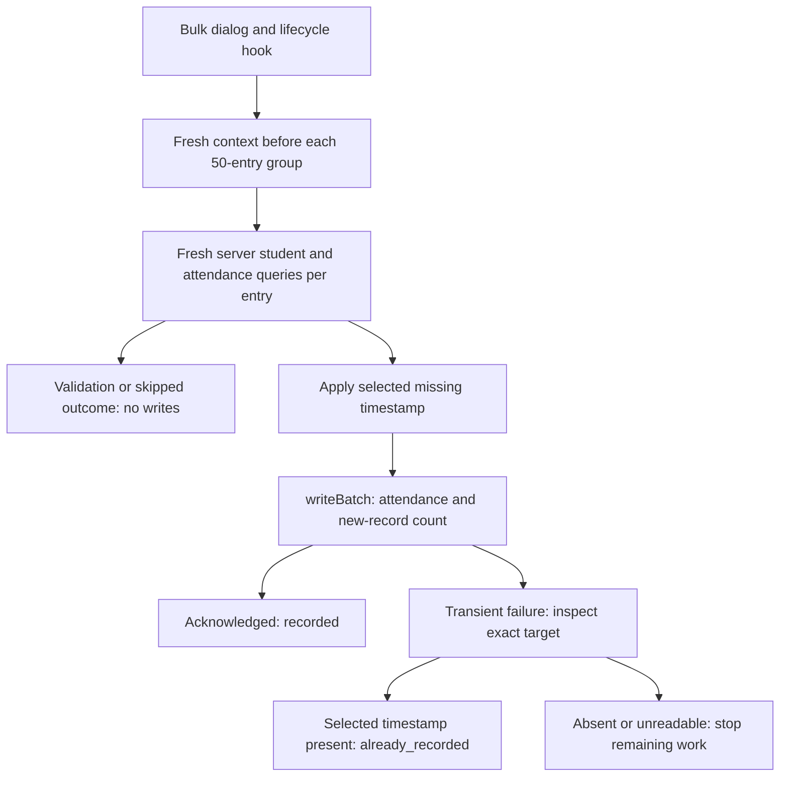

# Bulk Special Attendance — Implementation Report and Manual UAT

## 1. Delivered behavior

Completed-event attendance pages offer **Bulk Attendance** after the existing Check-in/Check-out selection. The selected mode is reused in instructions, validation, confirmation, processing, and results. Check-in and check-out require separate CSV imports.

The feature transfers physical attendance lists, not historical timestamps. Bulk uses browser `Timestamp.now()` when applying attendance, not `serverTimestamp()` or reconstructed paper-sheet times. Manual attendance retains its original behavior.

- One required CSV column: `Student ID`.
- No arbitrary total student-count cap; sequential groups of 50, with IDs required to match `XX-1-XXXXX` (digits 0–9, middle digit always `1`).
- Missing/ambiguous students, invalid entries, and duplicate input IDs do not block unrelated valid entries.
- Bulk skips a selected timestamp found on any matching attendance row; it does not intentionally replace existing timestamps. Concurrent writers remain a race limitation.
- Cross-program/faculty students require consolidated confirmation; new records receive manual-style remarks.
- Progress shows finished/total entries, group position, outcomes, and read-retry state.
- Validation and final results can be downloaded as CSV.
- Completed events with generated fines are ineligible. Fine-generation startup is not coordinated.
- Execution is browser-driven, without a background worker, durable resume, or attendance API route.
- No automated tests, test dependencies, scripts, or test configuration were added.

## 2. Actual changed-file inventory

Paths are relative to the project root. This inventory describes the simplified implementation, not removed intermediate designs.

### New files

| File | Purpose and implementation |
|---|---|
| `src/features/organization/log-attendance/bulk-attendance.types.ts` | Mode, entry, outcome, result, and progress contracts; labels and shared exact `XX-1-XXXXX` format validation. No database code. |
| `src/features/organization/log-attendance/bulk-attendance.utils.ts` | CSV parser, header/column validation, source rows, conservative normalization, duplicate/invalid-ID isolation, template download, reasons, and formula-safe report export. |
| `src/features/organization/log-attendance/hooks/useBulkAttendance.ts` | Instructions/upload/validation/processing/results lifecycle, confirmation, stale-operation guards, progress merging, navigation warning, unmount cancellation, and refresh callback. |
| `src/features/organization/log-attendance/components/BulkAttendanceDialog.tsx` | Entry action and controlled dialog stages, event/mode context, template, file input, mismatch warning, confirmation checkbox, progress, and validation report. |
| `src/features/organization/log-attendance/components/BulkAttendanceResultDialog.tsx` | Summary, interrupted-state guidance, complete CSV report, and 25-row paginated details; exports `BulkAttendanceResults` for the shared dialog. |
| `src/firebase/bulkAttendance.ts` | **All bulk database queries/writes:** fresh eligibility and per-entry server reads, sequential groups of 50, read-only retries with jitter, auto-ID `writeBatch` mutations, uncertain-write target inspection, conservative stop behavior, cancellation checks, and cache invalidation. |
| `BULK_SPECIAL_ATTENDANCE_REPORT.md` | This implementation inventory, limitations, validation record, and manual staging UAT. |

### Modified files

| File | Purpose and implementation |
|---|---|
| `src/features/organization/log-attendance/components/AttendanceInterface.tsx` | Bulk action for completed/no-generated-fines events after mode selection and with a selected schedule window; refreshes recent attendance after writes. |
| `src/features/organization/log-attendance/components/LogAttendancePage.tsx` | Delegates writes without swallowing errors or duplicating child success feedback; refreshes event data after attendance changes. |
| `src/firebase/attendance.ts` | Original manual query + auto-ID create + update flow restored. Errors are rethrown and cache invalidation expanded. Original timestamp-overwrite, unknown-student fallback, and counter semantics are intentionally unchanged. No shared writer. |
| `README.md` | CSV workflow, separate modes, browser lifecycle, simplified writes, interruption guidance, and limitations. |
| `coral-ussc backend doc.md` | Restores auto-ID attendance schema descriptions and documents the bulk module, read retries, atomic batch scope, original manual semantics, and operational limits. Existing unrelated backend documentation is preserved; this document was already untracked. |

### Unchanged/restored

`src/firebase/fines/create/fines.ts` is restored to HEAD with **no content or fine behavior changes**. It is not part of the modified-file inventory. It no longer appears in the modified-file status. No fine markers, recovery protocol, or duplicate-aggregation changes are delivered.

No package dependencies, design tokens, index definitions, or testing infrastructure were changed.

### Removed from earlier iterations

- `src/firebase/attendanceWrite.ts`: removed shared writer and its identity/transaction architecture entirely.
- `src/firebase/attendance.server.ts`: removed Admin SDK attendance writer.
- `src/app/api/attendance/route.ts`: removed attendance HTTP route, token-verification boundary, and route-duration configuration.

These were new/untracked intermediate files, so removal need not appear as tracked deletions. None is part of the delivered architecture.

## 3. UI and design implementation

The existing member-import flow informs the template/upload layout, confirmation, progress, and report hierarchy without copying its hardcoded palette or member-creation logic.

New UI retains existing semantic classes such as `bg-card`, `text-card-foreground`, `bg-muted`, `text-muted-foreground`, `border-border`, `text-primary`, `bg-accent`, and `text-destructive`, with existing fonts, radii, shadows, and shared Dialog/Button/Input/Checkbox/Label/Progress primitives. Theme definitions were not changed.

The controlled dialog has a bounded viewport height, scrollable body, persistent footer, and wrapping long IDs/event names. Only one dialog is active. Errors/statuses use text rather than color alone. Native file input, labels, shared focus behavior, and status announcements support keyboard/assistive use. Runtime/mobile/accessibility acceptance remains unexecuted UAT.

## 4. CSV implementation

```csv
Student ID
24-1-00001
24-1-00002
```

- Exact single-column header, accepting surrounding whitespace and a UTF-8 BOM.
- CRLF/LF/CR records, quoted cells, escaped quotes, and quoted newlines parsed structurally.
- IDs remain strings; surrounding whitespace is trimmed, preserving leading zeros/hyphens.
- Entirely blank records are ignored.
- IDs must match `XX-1-XXXXX`: two ASCII digits, `-1-`, and five ASCII digits, for example `24-1-00001`. The exact-length check rejects extra characters; malformed IDs are skipped as `invalid_student_id` in CSV preparation and again in the Firebase bulk loop before student/attendance lookups. Manual attendance validation is unchanged.
- Duplicate detection spans the whole input, including group boundaries.
- Malformed quoting, extra columns, bad headers, and no usable data prevent writes.
- Downloads escape/quote values and protect spreadsheet formula-leading cells.
- Validation preview exceptions are bounded to 100; complete downloads include all entries. Final details use 25-row pagination rather than truncating the report.

Files/results are held in browser memory. No arbitrary count cap does not imply unlimited device memory, service capacity, or execution time.

## 5. Database architecture and atomicity

All bulk queries/writes are in **`src/firebase/bulkAttendance.ts`**, using the existing browser Firebase SDK/authentication. Manual `logAttendance` remains separate in `attendance.ts`. There is no attendance API, fetch/token transport, Admin dependency, or hosting-route timeout.



### Eligibility and lookup

`validateBulkAttendance(eventId, type, entries, signal?)` and `applyBulkAttendance(eventId, type, entries, confirmOutside, onProgress?, signal?)` return ordered per-entry results. They process sequential groups of 50 internally, not 50 HTTP requests or one 50-student atomic mutation.

Before each group, fresh server reads check:

- Current signed-in, nondeleted `admin` or `super-admin`, with an organization.
- Nondeleted completed event, matching operator organization, and `finesGenerated !== true`.
- Configured start/end window for the selected attendance mode.
- Nondeleted/nonarchived organization and valid operator access level (1, 2, or 3); program/faculty configuration for levels 1/2 respectively.

Session changes are checked between entries and before writes. There is no new active-term restriction or cross-organization super-admin bypass. Context is refreshed per group, not transactionally before each mutation; changes within a group can race. These are application checks, **not a security authority**; deployed Firestore rules enforce access.

Each entry receives fresh `getDocsFromServer` queries for global exact `studentId` with `isDeleted == false` (limit two to detect ambiguity) and existing attendance by `eventId` plus `userId`. This is not an approved-roster-only lookup. `eventAttendees.userId` is the trimmed **student ID string**, not the user document ID.

Missing/ambiguous students and repeated input IDs are skipped. If any matching attendance row already has the selected timestamp, the entry is `already_recorded`. Outside-scope students require confirmation; only new records receive the mismatch remark. Validation performs no writes, and its results are not a guarantee of later eligibility.

### Existing schema and per-entry writes

| Target | Behavior |
|---|---|
| New `eventAttendees/{autoId}` | Allocated with `doc(attendance)`; contains event/student identifiers, user snapshot, selected `Timestamp.now()`, null opposite timestamp, partial status, and optional remark. |
| Existing `eventAttendees/{existingId}` | Prefer a row with the opposite timestamp, otherwise the first returned match. Write only the selected field and derived status; preserve the opposite timestamp. |
| `events/{eventId}.attendees` | Incremented in the same batch only when a new record is created, including check-out-first creation. Existing-row updates do not increment it. |

A new attendance record and its counter update commit atomically in one `writeBatch`, consistent with the existing counter pattern. Status is `present` when both timestamps exist on the selected target, otherwise `partially present`. Historical duplicate rows/counters are not migrated, merged, or repaired.

There are **no transactions, hashes, identity documents, new collections, schema migrations, or fine-marker coordination**. Fresh lookup and mutation are separate operations. Simultaneous imports/manual writes may create duplicate auto-ID records, race on timestamps, or affect counts. Atomic creation/count coupling is not a strict cross-browser uniqueness guarantee. Manual overwrite/fallback behavior is intentionally not hardened by this feature.

## 6. Processing and interruption behavior

`readWithRetry` permits up to **three read retries after the initial attempt**, with capped exponential backoff and jitter, for transient codes (`deadline-exceeded`, `resource-exhausted`, `aborted`, `internal`, `unavailable`, `unknown`). It covers context, per-entry queries, and target reconciliation. Permanent errors are not treated as transient retries.

**Application code never resends an uncertain mutation.** Each entry submits its batch once. The Firebase SDK's internal retry/pending-commit behavior is separate and may outlive the UI operation.

After a transient commit failure:

1. Read the exact target document from the server, using the read-only retry budget.
2. If its selected timestamp is present, report `already_recorded`: attendance is confirmed present, but not necessarily created by this attempt.
3. If absent or unreadable, stop. Mark the current and all remaining entries `not_processed` with an unconfirmed/interrupted reason; do not submit more writes or automatically resend the mutation.

An access error stops remaining work. Other nontransient per-entry failures can be reported as `failed`, allowing unrelated entries to continue. Earlier confirmed results remain in the report; `not_processed` entries do not advance finished progress. Apply invalidates attendee/recent/check/event/list caches even after interruption.

Abort is checked before reads, between entries, and before submission. It stops future work when observed, but **cannot cancel or roll back a submitted SDK commit**. Pending commits may complete after interruption. Keep the page open, avoid simultaneous imports/manual writes for the same attendance, and **inspect attendance before re-uploading**. This is not a globally guaranteed safe-retry mechanism or durable resume.

The UI waits up to 30 seconds for each submitted commit, or stops waiting on abort, then treats the result as uncertain and attempts read-only reconciliation. This bounds waiting, not the SDK operation: a queued commit may still complete later. The mutation is not resent, and an absent/unreadable target stops remaining work. There is no attendance server-route timeout.

## 7. Fine generation and operational boundaries

`src/firebase/fines/create/fines.ts` is unchanged from HEAD. No startup markers, lock ownership, write receipts, fine recovery protocol, or duplicate-attendance aggregation changes remain.

Bulk checks the existing `finesGenerated` flag before each group. It does not synchronize with fine-generation startup or snapshot reads; fines can start while a group is running. **Finish and verify attendance before generating fines; do not run these operations simultaneously.** Generated fines block later bulk eligibility checks, but there is no atomic ordering guarantee between attendance writes and fine generation.

## 8. Validation record

No automated tests or testing tools were added. The simplified implementation was checked with the existing build/type tools and the installed Next flat lint configs. Browser/Firebase UAT and deployed-rule verification remain unexecuted.

| Check | Current status |
|---|---|
| `npx tsc --noEmit --incremental false` | Passed for the simplified implementation. |
| `npm run build` | Passed: compilation, TypeScript, page generation; no attendance API route. |
| Targeted lint | All six new TypeScript/TSX files passed using the installed Next flat configs directly. |
| Final implementation `git diff --check` | Passed; Git emitted line-ending normalization notices but no whitespace errors. |
| Browser/Firebase staging UAT | Not executed; scenarios below are staged instructions only. |
| Deployed rules/index compatibility | Not executed; release verification required. |

The build retained existing deprecated-middleware and caught members-cache `localStorage is not defined` SSR warnings, but completed successfully. Normal project lint has the previously observed circular-configuration error; direct Next flat configs were used for targeted new-file lint. Existing unrelated diagnostics were not refactored. `git diff --exit-code -- src/firebase/fines/create/fines.ts` passed, confirming no fine-generation content changes. These checks are not browser/Firebase UAT or deployed security verification.

## 9. Deployment and operational notes

1. Use existing browser Firebase configuration/authentication. Attendance requires no Admin credentials, new server endpoint, or route-duration allowance. Other server features may still require Admin credentials.
2. Deployed Firestore rules are not available here. Verify existing user/operator/organization/event reads, exact student and attendance queries, attendance creates/updates, target reconciliation reads (including a missing new target), and event-count writes. No new collections or rule schema are needed. Do not broadly loosen rules to make imports pass.
3. Browser checks cannot establish authorization. Independently verify narrowly scoped deployed permissions and atomic new-attendance/count behavior. No new rules were added and deployed security is not certified.
4. No indexes were added. Verify equality queries/existing index merging in staging. Index/permission failures must be actionable and must not cause repeated uncertain writes.
5. Query/write membership is not atomic. Avoid simultaneous imports/manual writes; no global uniqueness or historical duplicate repair is promised.
6. Large matching-attendance queries are unbounded. Browser memory, latency, payloads, connectivity, SDK/service quotas, and rules access limits constrain practical scale despite no arbitrary file-count cap.
7. Missing-ID reports describe possible registration/typo/transfer causes, not a diagnosis. No automatic registration/restoration, roster change, timestamp backdating, financial correction, historical-term enhancement, or persistent import history was added.

## 10. Quick UAT — optimistic route

**Start here.** This is the small solo-testing checklist for the normal successful workflow. The extended scenarios below are optional follow-up coverage, not the checklist to work through for this initial pass. These steps are provided, not executed.

### Minimal setup

- Use staging and your normal organization administrator account.
- Choose one completed event with both check-in and check-out windows configured and no generated fines.
- Choose **three existing students in your organization** who have no attendance for that event.
- Use a stable connection. Do not run another attendance import or generate fines during this pass.
- Note the event's current attendee count.

### Seven-step checklist

| Step | Action | Expected result |
|---|---|---|
| 1 | Open **Log Special Attendance**, select **Check-in**, then click **Bulk Attendance**. | Instructions show the correct event and Check-in. Continue opens the upload field. |
| 2 | Download the template. Keep the `Student ID` header and add the three real student IDs, one per row. Save as CSV and upload it. | Validation shows **3 entries ready**, with no skipped or unavailable entries. |
| 3 | Confirm the event/mode checkbox and start the import. Keep the dialog open. | Progress reaches **3 / 3 finished**. The report shows **3 newly recorded**, with no failures or unconfirmed entries. A small import may finish too quickly to inspect intermediate progress. |
| 4 | Download the report, close the dialog, and open/refresh the attendee list. | Download contains all three IDs with Check-in/Recorded outcomes. Each student has check-in but no check-out; event attendee count increased by **3**. |
| 5 | Return to the attendance page, switch to **Check-out**, and import the same CSV as a separate operation. Confirm and start. | Validation shows 3 ready; report shows **3 newly recorded** for Check-out. |
| 6 | Inspect the attendee list again. | All three students now have both timestamps and present status. Earlier check-in timestamps remain unchanged. Event attendee count is still the original count **+3**, not +6. |
| 7 | With **Check-out** selected, upload the same CSV once more. | Validation lists all three as **already recorded**, with **0 ready**. No new import is necessary; timestamps and attendee count remain unchanged. |

**Record the outcome:** `Date: ____ · Event: ____ · Steps 1–7: Pass / Fail · Notes: ____`

If all seven steps pass, the normal check-in/check-out transfer workflow has passed a basic smoke UAT. This does **not** establish network-failure recovery, large-file batching, concurrency, or deployed security correctness. Those remain untested unless separately exercised. No developer tools, database edits, or failure simulation are needed for this quick pass.

## 11. Extended manual UAT setup — optional follow-up

Run only in staging with disposable events/students. No test framework, test files, or new tooling is required. **These scenarios are provided, not executed.**

Prepare:

- Administrator A with correctly configured organization/scope, administrator B from another organization, and non-admin/signed-out sessions.
- Upcoming, ongoing, completed, archived/deleted, and completed-with-fines events; both selected schedule windows on the normal completed fixture.
- Existing in-scope students, an outside-program/faculty student, a nonexistent ID, a soft-deleted student, and a disposable ambiguous duplicate student ID.
- No-attendance, check-in-only, check-out-only, and both-timestamps fixtures. Save original timestamps, row IDs, and event counts.
- Existing duplicate auto-ID attendance rows: one with the selected timestamp, and a separate fixture with only opposite timestamps/empty rows.
- More than 50 CSV entries, a duplicate after row 50, invalid IDs, malformed CSVs, and enough exceptions for pagination.
- Browser developer tools for offline/throttling, two sessions for observing concurrency limitations, and controlled staging permissions for denial/atomicity checks. Do not broaden production rules.

For every mutation, inspect UI results **and** Firestore rows/counters. Record outcome, evidence, pass/fail, and environment externally. For interruptions, wait/reconnect and inspect pending commit completion before any re-upload. Do not treat an absent timestamp at one instant as proof that an outstanding commit cannot later arrive.

## 12. Extended manual UAT cases — optional follow-up

| ID | Steps | Expected result |
|---|---|---|
| 01 | Open upcoming/ongoing events and inspect actions. | No Bulk Attendance action; existing manual flow remains available as before. |
| 02 | On a completed event, choose Check-in and open Bulk Attendance. | Instructions show the correct event/Check-in; Continue opens upload. |
| 03 | Repeat with Check-out. | Every stage/report identifies Check-out; a separate import is required. |
| 04 | Inspect archived/deleted/generated-fines events and call bulk functions from a stale session. | Bulk is unavailable or context rejects it; no bulk writes. |
| 05 | Remove the selected mode's start/end configuration before validation. | Context rejects the missing window; no attendance writes. |
| 06 | Download template, fill IDs, and upload. | Exact single `Student ID` column accepted; ready counts correct. |
| 07 | Upload `.txt`, empty/header-only CSV, wrong/duplicate headers, and extra columns. | Clear file-level errors; no writes. |
| 08 | Upload unmatched quotes or text after a closing quote. | Malformed structure rejected, not shifted into IDs. |
| 09 | Use BOM, CRLF/LF/CR, quoted IDs, whitespace, leading zeros/hyphens, and blank lines. | IDs preserved as strings, surrounding whitespace trimmed, blank records ignored, source rows retained. |
| 10 | Mix invalid formats (`24-2-00001`, `2A-1-00001`, `24-1-1234`, extra characters, nulls, or quoted newlines) with valid `XX-1-XXXXX` rows. | Invalid rows isolated; unrelated valid rows remain eligible. |
| 11 | Repeat an ID before and after row 50. | Later duplicate reported with correct source row; no second mutation from this input. |
| 12 | Mix valid, nonexistent, and soft-deleted students. | Missing/deleted matches skipped with explanatory guidance; valid rows proceed. |
| 13 | Include an ambiguous duplicate student ID. | Ambiguous row skipped; no arbitrary student chosen. |
| 14 | Include outside-program/faculty students, review warning, then cancel. | Consolidated warning; no writes without confirmation. |
| 15 | Confirm the mismatch import. | New rows have manual-style remarks; existing rows do not have snapshot/remarks rewritten. |
| 16 | Validate eligible IDs and inspect Firestore before Start. | Validation writes neither attendance nor counters. |
| 17 | Apply Check-in to students without attendance. | Auto-ID records with check-in/current browser application time, null check-out, partial status; one counter increment per new row. |
| 18 | Apply separate Check-out to those students. | Original row IDs/check-in preserved; check-out added, present status; count unchanged. |
| 19 | Apply Check-out first for a new student. | New partial row and count increment together; no implied check-in. |
| 20 | Apply Check-in to an existing check-out-only record. | Same row updated; check-out preserved, present status, count unchanged. |
| 21 | Re-upload already-recorded timestamps. | `already_recorded`; exact stored timestamps/counts unchanged. No-op validation report remains downloadable. |
| 22 | Cancel before Start; reopen. | No writes; file/confirmation state resets. |
| 23 | Change selected file after validation; select same filename after interrupted validation. | No stale preview imported; same file can be selected again. |
| 24 | Import more than 50 valid entries and watch network/progress. | Sequential per-entry processing in 50-entry groups; fresh context per group; accurate finished/total/group counts; no attendance HTTP requests. |
| 25 | Cause a transient read interruption and reconnect within budget. | Read retry indicator/backoff; at most three retries after initial read; application does not resend a mutation. |
| 26 | Keep context/entry reads unavailable beyond retry budget. | Processing stops; prior confirmed results retained; remaining entries `not_processed`, not successes. |
| 27 | If reproducible in staging, make a commit return a transient error after the selected timestamp reaches its target. | Exact target inspected; `already_recorded` confirms presence without attributing creation to this attempt; no application resend. If not reproducible, record untested rather than infer a pass. |
| 28 | Interrupt a commit whose target remains absent/unreadable, or keep it pending beyond the 30-second UI wait. | Current and remaining rows stop as `not_processed`/unconfirmed; no further mutation submissions. Pending SDK commit may still finish. |
| 29 | After interruption, reconnect, inspect target attendance/pending completion, then re-upload only after review. | Present timestamps skipped; missing entries can be reconsidered. No claim that immediate re-upload or concurrent recovery is globally safe. |
| 30 | Attempt Escape/backdrop/close/mode changes during busy stages. | Busy dialog resists accidental dismissal; mode stays fixed. |
| 31 | Navigate away during reads/between entries, and separately after commit submission. | Further work stops when abort observed; submitted commit may complete; no rollback/cancellation promise. |
| 32 | Refresh/close tab during processing. | Browser warning where supported; no background-job/durable-resume promise. Inspect attendance before retry. |
| 33 | Use two staging sessions for the same student, including manual versus bulk. | Record observed races/duplicates/timestamp/count effects as known limitations; do not require cross-browser uniqueness or unchanged manual overwrite behavior. Normal operation must avoid overlap. |
| 34 | Set `finesGenerated=true` before validation or before the next group. | Next context check blocks bulk; prior confirmed writes remain. |
| 35 | On a disposable fixture, observe fine generation overlapping an already-running group. | No startup lock/atomic snapshot ordering is promised. Record the race; operational acceptance requires attendance completion before fines. Fine code/schema is unchanged. |
| 36 | Archive/delete event or change organization eligibility before Start/between groups. | Fresh context stops further groups; no promise of per-row transactional eligibility within a group. |
| 37 | Sign out/change account between entries. | Further work stops when session change/abort/access denial is observed; submitted commits may still finish. |
| 38 | Use wrong-org/non-admin sessions; attempt unauthorized direct SDK attendance/count writes in staging. | Bulk functions reject invalid context; deployed rules independently deny unauthorized writes. Permissive rules are a release blocker. |
| 39 | Download validation/final reports; reconcile all source rows, mode, outcomes, reasons, and totals. | Complete report, not just preview/page; formula-leading values neutralized. `not_processed` not counted as finished success. |
| 40 | Inspect recent attendance, attendee list, attendance-check state, and event count after completion/interruption. | Attendance/event/list caches refreshed; displayed data reflects server state after pending writes settle. |
| 41 | Use an accessible historical completed event. | No new active-term restriction; completion/window/fines checks still apply. |
| 42 | Compare theme/member import on desktop and narrow/mobile width with long IDs/event names. | Existing semantic colors/fonts/radii; wrapping, body scroll, reachable footer; no clipped controls. |
| 43 | Navigate dialog/results with keyboard and inspect screen-reader labels/status. | Logical focus/labels; textual errors/status, not color-only communication. |
| 44 | Generate over 100 validation exceptions and multiple final pages. | Preview remains bounded; 25-row pagination works; complete downloads retain every row. |
| 45 | Use duplicate legacy rows where any row has the selected timestamp. | Bulk skips the whole entry without modifying any duplicate, timestamp, or count. |
| 46 | Use existing empty/counterpart rows with no selected timestamp. | Prefer a counterpart row, otherwise first returned row; update only selected field/status; no new row/count increment; other rows unchanged. |
| 47 | With no attendance, deny event-count update in controlled staging permissions and attempt creation. | Entire batch denied: no attendance-only creation or count-only update. Restore intended scoped permissions. |
| 48 | Deny attendance update or student query; inspect error/report behavior. | No unsafe mutation resend; access failures stop remaining work; other failures are clear. No broad permission workaround. |
| 49 | On disposable manual fixtures, repeat manual attendance and exercise original unknown-student path; induce a write error. | Original overwrite/fallback semantics remain, not bulk skip semantics; errors propagate to child feedback and successful writes invalidate expanded caches. |
| 50 | Inspect schema/deployment and a larger duplicate fixture using existing staging indexes/rules. | Only existing collections/auto-ID attendance and event-count writes required; no migration/new collection/Admin/route requirement. Record practical query/latency limits rather than promise unlimited scale. |

## Acceptance boundary

Documentation reflects the simplified browser bulk writer and separate original manual flow. Build, standalone TypeScript, targeted new-file lint, and whitespace checks passed; all manual UAT and deployed-rule/index checks remain unexecuted. Release acceptance requires those checks, atomic batch permission verification, interruption/reconciliation review, and operator guidance to avoid simultaneous imports/manual attendance/fine generation. No global uniqueness, guaranteed safe retry, timestamp-race prevention, cancellation of pending SDK commits, or deployed security guarantee is claimed.
